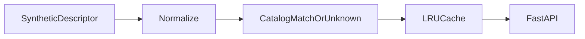

1. Clean messy merchant strings into merchant names/categories via an API with accuracy benchmark and caching.

2. Result:
   Labeled synthetic descriptors: 600  
   Merchant-ID accuracy: 1.0  
   API p99 latency: 1.8739999504759908 ms  

   Measured with `make bench`: [raw results](evidence/bench.json), [command output](evidence/checks.log), [environment](evidence/environment.json).

3. Architecture:


4. Run it:
```sh
make setup
make lint test bench
make demo
```

5. Decisions and limits: Synthetic merchants, payment descriptors and labels only. Matching uses a fixed original catalog with normalization and conservative fuzzy matching; this is not a financial network integration. Exact unknown labels count toward accuracy, and ambiguous matches remain unknown. API timing includes local FastAPI TestClient transport, not internet latency. Cache keys are bounded and scoped to this fixed catalog; dynamic catalog invalidation is not implemented. Raw labels, predictions and latency samples are retained in evidence/.

6. Next: Calibrate thresholds on independent synthetic corruptions and version the cache with catalog updates.
